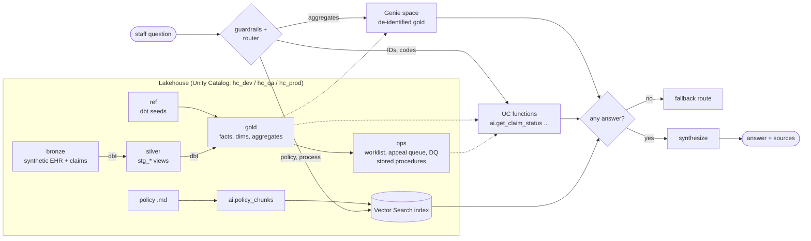

# Healthcare Agent Lakehouse

An end-to-end Databricks project: **dbt** builds a medallion lakehouse from synthetic EHR and claims data,
**SQL functions and stored procedures** run the operational rules, and a **custom LangGraph agent** decides
for every question whether to ask **Genie** (numbers), call **Unity Catalog functions** (record lookups) or
search **policy documents** (RAG). A **Lakeflow Job** orchestrates it, and **GitHub Actions** promote the same
commit from **Dev → QA → Prod** with Databricks Asset Bundles.

> All data is synthetic and the organization ("Riverbend Health Network") is fictional. Nothing here is
> clinical decision support. See [Using real PHI](#using-real-phi) before pointing it at real data.

New here? Start with **[HANDS_ON.md](HANDS_ON.md)**, a lab guide that walks through every layer.

## Architecture



## How the agent decides

| Route | Used for | Example |
|---|---|---|
| **Genie** | counts, rates, averages, trends, rankings over many records | "Readmission rate by facility for the last 6 months" |
| **UC functions** | one entity by ID or exact codes | "Status of claim CLM-0000017", "Does PAY-01 need PA for 72148?" |
| **Documents** | policies, processes, definitions, eligibility, deadlines | "How long do we have to appeal a Medicare Advantage denial?" |
| **Several** | a lookup plus what to do about it | "CLM-0000017 was denied for missing PA, what next?" → UC + docs, merged |
| **Guardrail** | individual medical advice, emergencies, bulk PHI export | answered with a fixed safe response; no tools called |

Routing is **hybrid** (`agent/config.yaml → routing_mode`):

1. **Guardrails** (regex) run first.
2. **Rules** (`agent/routing.py`) score each route from identifiers (PAT-, CLM-, CPT + payer, drug pairs)
   and wording. If confidence ≥ `rule_confidence_threshold`, that decision is used with no LLM call.
3. Otherwise an **LLM classifier** with structured output decides, given the rule scores and extracted
   entities as hints.
4. If every chosen route fails or comes back empty, **fallbacks** try the next route
   (UC → Genie → docs; Genie → docs; docs → Genie).
5. Follow-up questions are rewritten into standalone questions first, and the Genie conversation ID is
   returned in `custom_outputs` so callers can keep a Genie thread going.

Every response's `custom_outputs` shows `routes`, `route_source` (rules / llm / guardrail / forced),
`route_reason`, `routes_tried` and any `errors`, and the full trace is in MLflow.

## Repository layout

```
databricks.yml                 bundle: variables and targets personal / dev / qa / prod
resources/hc_agent_job.yml     end-to-end job + daily refresh job
src/
  hc_synth.py                  synthetic data generator (pure Python, unit-tested)
  chunking.py                  markdown chunker (pure Python, unit-tested)
  00_setup.py                  catalog, schemas, volume
  01_generate_bronze.py        bronze tables (full or incremental)
  02_create_uc_functions.py    agent tool functions (SQL + one Python UDF)
  03_build_vector_index.py     chunks + Delta Sync vector index
  04_genie_space.py            validates the Genie space
  05_log_and_evaluate_agent.py log, evaluate, gate, register in UC
  06_deploy_agent.py           agents.deploy to Model Serving
  07_smoke_test_endpoint.py    one question per route against the endpoint
  08_run_sql.py                runs sql/*.sql on the SQL warehouse
dbt/                           seeds, staging (silver), marts (gold), tests, docs → UC comments
sql/
  01_ops_tables.sql            worklist, appeal queue, appeal events, DQ results
  02_functions.sql             scalar + table-valued SQL functions, 2 more agent tools
  03_procedures.sql            4 stored procedures
  04_run_daily_procedures.sql  SQL script that CALLs them
  examples.sql                 copy-paste examples for the SQL editor
docs/policies/*.md             fictional policies the RAG route searches
genie/space_setup.md           how to create the Genie space (tables, instructions, trusted SQL)
agent/                         agent.py (LangGraph + ResponsesAgent), routing.py, config.yaml
eval/eval_set.jsonl            22 questions with expected route and guidelines
tests/                         41 unit tests incl. the full agent graph with fake services
.github/workflows/             ci.yml, cd.yml (Dev → QA), release-prod.yml
```

## The job

```
setup ─► generate_bronze ─► dbt_build ─► uc_functions ─► sql_objects ─► run_procedures ─┐
  │                             └──────► genie_check ──────────────────────────────────┤
  └────► docs_index ───────────────────────────────────────────────────────────────────┴─► log_and_evaluate
                                                                                              │
                         eval_gate (eval_passed == "true") ─► deploy_agent ─► smoke_test ◄─────┘
```

`hc_daily_refresh` (05:30 ET) appends a day of new data, runs `dbt build` (incremental `fct_claims`),
the daily stored procedures (DQ checks fail the run on errors), and re-syncs the vector index.

## SQL layer

| Object | Type | Does |
|---|---|---|
| `ops.sp_refresh_care_management_worklist(as_of, OUT active_count)` | procedure | applies the Care Management eligibility rules (LACE ≥ 10, 2+ admits, 3+ ED visits, A1c > 9) with MERGE |
| `ops.sp_build_appeal_queue(OUT new_items, OUT expired_items)` | procedure | queues appealable denials with priority and recommended action per denial code; expires missed deadlines |
| `ops.sp_log_appeal(claim_id, action, notes, OUT result)` | procedure | validates and records an appeal action; `SIGNAL`s on bad input, closed appeals, missed deadlines |
| `ops.sp_run_data_quality_checks(fail_on_error, OUT failed_checks)` | procedure | business-rule DQ checks logged to `ops.dq_results` |
| `gold.fn_denials_by_payer(start, end)` | table function | denial rate, dollars and top code by payer |
| `gold.fn_readmission_rate(start, end, facility)` | table function | 30-day readmission rate by facility |
| `gold.fn_patient_encounter_history(patient_id)` | table function | a patient's encounters with billed/paid totals |
| `gold.fn_lace_points`, `fn_age_band`, `fn_mask_member_id` | scalar | shared logic |
| `ai.*` (8 functions) | scalar | agent tools: patient summary, claim status, prior auth, formulary, drug interaction, readmission risk, care-management status, appeal status |

Stored procedures need Databricks SQL or DBR 17+, which is why `08_run_sql.py` sends them to the SQL warehouse.

## Environments and CI/CD

| Target | Who deploys | Catalog | Notes |
|---|---|---|---|
| `personal` | you, from your laptop | `hc_sandbox` | development mode: prefixed names, paused schedules |
| `dev` | `cd.yml` on every merge to `main` | `hc_dev` | runs the full job |
| `qa` | `cd.yml` after a reviewer approves the `qa` GitHub Environment | `hc_qa` | same commit as Dev; eval threshold 0.90; tags the commit `qa-*` |
| `prod` | `release-prod.yml` on a `v*` tag | `hc_prod` | refuses commits that have no `qa-*` tag |

Pull requests run `ci.yml`: ruff, pytest, `dbt parse --warn-error`, and `bundle validate`.

### One-time setup

1. **Workspaces and catalogs**: create `hc_dev`, `hc_qa`, `hc_prod` catalogs (or let `00_setup` create them if
   the service principal may) and a serverless SQL warehouse per workspace.
2. **Service principal** per environment, with an OAuth secret. Grant it `USE CATALOG`/`CREATE SCHEMA` on the
   catalog, `CAN USE` on the warehouse, and access to the LLM and embedding endpoints.
3. **GitHub Environments** `dev`, `qa`, `prod` (Settings → Environments). In each:
   - variables: `DATABRICKS_HOST`, `WAREHOUSE_ID`, `GENIE_SPACE_ID`
   - secrets: `DATABRICKS_CLIENT_ID`, `DATABRICKS_CLIENT_SECRET`
   - `qa` and `prod`: add **Required reviewers**
4. **Branch protection** on `main`: require the CI checks and one review.
5. **Genie space** per environment: follow `genie/space_setup.md`, then set `GENIE_SPACE_ID`.

The Databricks CLI reads `BUNDLE_VAR_<name>` environment variables for bundle variables, so no workspace
IDs live in Git.

## Local development

```bash
python -m venv .venv && source .venv/bin/activate
pip install -r requirements-dev.txt
pytest -q && ruff check agent src tests

databricks auth login --host https://<dev-workspace>
databricks bundle deploy -t personal --var="warehouse_id=<id>"
databricks bundle run   -t personal --var="warehouse_id=<id>" hc_agent_end_to_end
```

dbt locally: copy `dbt/profiles.example.yml` to `~/.dbt/profiles.yml`, export `DATABRICKS_HOST`,
`DATABRICKS_TOKEN`, `DATABRICKS_WAREHOUSE_ID`, `HC_CATALOG`, then `cd dbt && dbt deps && dbt build`.

## Using real PHI

This demo is designed so the safe path is the default, but real data needs more:

- A HIPAA-eligible workspace (compliance security profile) and a BAA with Databricks and any model provider.
- Genie only sees `dim_patient_deid` and aggregates; keep identified tables out of the space.
- Turn on the column masks sketched at the end of `02_create_uc_functions.py`, and row filters by facility.
- Use on-behalf-of-user authentication for Genie and UC functions so users only see what they're allowed to.
- Enable inference tables and review traces; keep the guardrails and add clinical review of all prompts.

## Things to check against your workspace

These depend on workspace features and package versions that move quickly:

- Stored procedures and SQL scripting (Databricks SQL / DBR 17+).
- The `dbt_task` builds its dbt profile from `warehouse_id`, `catalog` and `schema`; if your workspace
  needs an explicit profile, add `profiles_directory` pointing at a profiles file that reads env vars.
- `databricks-langchain` / `unitycatalog-langchain` import paths for `GenieAgent` and `UCFunctionToolkit`.
- Databricks recommends Databricks Apps for new agent deployments; `06_deploy_agent.py` uses Model Serving
  because it deploys a registered model from a job in one call.
